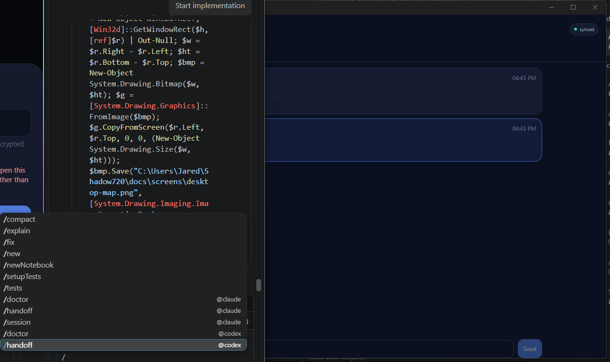
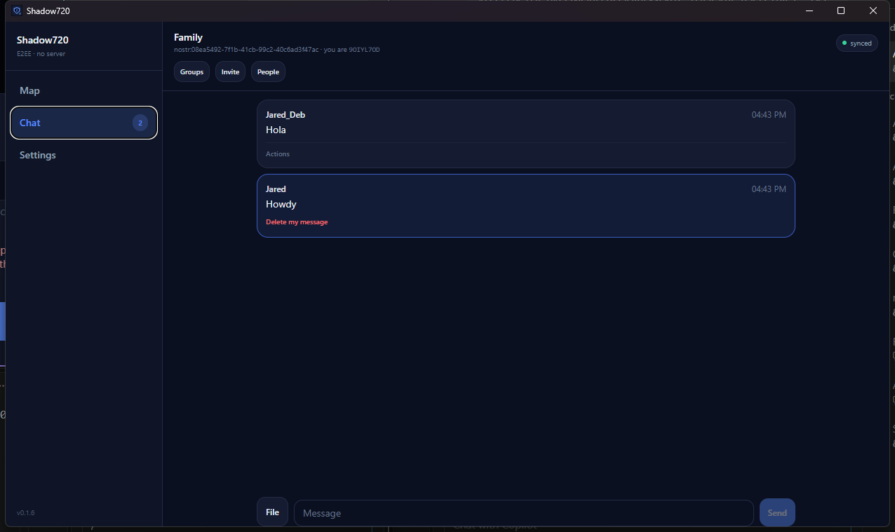
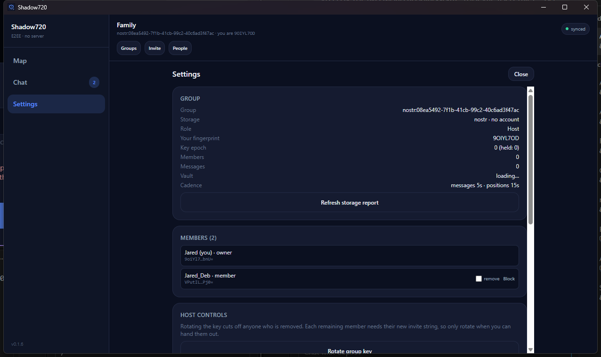
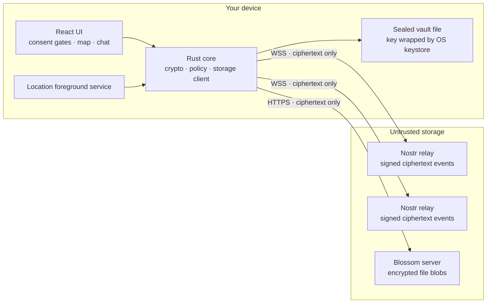

<div align="center">


# Shadow720

### Live location, chat, and file sharing for your group — with no server, no account, and no one who can read it.

**Free forever. $0 to run. No subscription, no per-seat pricing, no hosting bill.**

[](./src-tauri)
[](https://v2.tauri.app)
[](./src)
[](#download)
[](./LICENSE)

[Download](#download) · [What it does](#what-it-does) · [Security](#security-model) · [Build it](#building) · [Limitations](#known-limitations)

</div>

---

<div align="center">

| **See everyone, live** | **Talk without being read** | **Stay in control** |
|:---:|:---:|:---:|
|  |  |  |
| A real map, real trails, real activity — walking, cycling, driving — refreshed every 15 seconds. | Messages and files sealed on your phone before they leave it. | Key epochs, member roles, rotation, and a wipe button that actually wipes. |

**On desktop the app opens wide** — a 1260×720 window with a left-hand navigation rail, the map beside the member list, and a resizable layout that adapts to your screen.

| **Desktop map** | **Desktop chat** | **Desktop settings** |
|:---:|:---:|:---:|
|  |  |  |

</div>

---

## What it does

Shadow720 is a **private group app** for the people you actually trust: your family, your hiking group, your crew. It shows everyone on a live map, carries a group chat, and moves files between you.

The difference is what it *doesn't* have.

> **There is no server. There is no account. There is no company in the middle.**
>
> Every position, message, and file is encrypted on your device with `XChaCha20-Poly1305` and signed with `Ed25519` **before** it is stored anywhere. The place it gets stored — a public Nostr relay — only ever holds ciphertext. It cannot read your group, and neither can we.

### The cost

| | Shadow720 | Typical family-locator app |
|---|---|---|
| Monthly price | **$0** | $5–$15 per group |
| Per-seat fee | **$0** | Often |
| Server to run | **None** | Required |
| Who can read your location | **Only your group** | The vendor |
| Account required | **None** | Yes, per member |
| Data retention you control | **Yes — you hold the keys** | Vendor policy |

There is nothing to host, so there is nothing to pay for. The storage is free-tier infrastructure that already exists: public Nostr relays and Blossom blob servers. The app is MIT-licensed and the whole thing runs on your hardware.

### What's new in 0.1.9

- **Positions survive a lost connection.** A fix that cannot reach a relay is no longer thrown away. It is sealed into an on-device outbox and published automatically when the connection returns, so a tunnel, a flight, or a dead Wi-Fi network no longer leaves the group looking at a stale pin.
- **The offline stretch is in your history.** Cached fixes are also written to the local track log as they are captured, so the map's history view shows where you actually went instead of drawing a straight line across the gap.
- **You can see that sharing is deferred.** A banner reports how many positions are cached and offers a retry, and the settings panel shows the same count. A queued fix is not an error, so it no longer raises one.
- **The cache is bounded and encrypted.** At most 512 fixes, nothing older than 24 hours, sealed with the group key beside the vault, and dropped when the vault is wiped. A device left offline for a week cannot grow it without bound.
- **The displayed build version is correct again.** `APP_VERSION` had been left at `0.1.7` through the 0.1.8 release, so a bug report quoted the wrong build. The bump script now updates and verifies it like every other declaration.
- **Every release now ships a signed APK.** The build script produced either the Play bundle or the sideloadable APK, never both, so a release could go out with nothing a user outside Play could install. Both are now built and attached on every run, signed with the same key and carrying the same `versionCode`.
- **Joining is a single paste.** Invites are now self-contained `GRP2-` codes: the wrapping key rides inside the token, so there is no join password to remember or transmit. Legacy `GRP1-` codes still work and are sealed with a password via `Argon2id`.
- **A demo video for the Play location declaration.** The full consent flow — terms gate, location disclosure, OS permission dialog, background-location settings trip, lock-screen proof, and leave-and-wipe — is recorded and verified against the shot list in `docs/play/`.

### What's new in 0.1.9 (earlier)

- **Tap a name to fly there.** Selecting a member in the roster centres and zooms the map on them, and turns off "Following you" so the view stays put.
- **A month of history.** Every device keeps a 31-day track log, grouped by day and week, with distance, dominant activity, and lowest battery per day. It is sealed with the group key and never published.
- **Activity that doesn't flicker.** A rolling median plus hysteresis means one bad GPS fix can no longer relabel a stationary member as "driving".
- **Battery that actually works.** Level and charging state were hardcoded to `0`; they are now read from the platform and colour-coded, with a per-day low in the history view.
- **Background location survives the app closing.** The foreground service publishes straight into the Rust core over JNI instead of broadcasting to a webview that no longer exists, so the pin keeps moving with the screen off.
- **Background location survives the app being killed.** Android restarts a sticky service in a fresh process where the Tauri bootstrap never runs. The service now opens the vault itself through the platform Keystore, so a low-memory kill no longer silently stops publishing.
- **A stationary member no longer looks offline.** The heartbeat was 15 minutes while the staleness threshold was 5, so someone sitting still was drawn as offline for ten minutes out of every fifteen. The heartbeat is now 4 minutes.
- **Slow movement is no longer invisible.** The platform distance filter equalled the core's movement gate, so a device drifting under 15 m never produced a fix and could never heartbeat. The filter is now 5 m, below the gate.
- **Battery-efficient cadence.** The service asks Android for a fix only after a real distance, then widens the interval when you are stationary or the battery is low: 30 s moving, 10 s fast, 2 min still, 5 min on low battery.
- **Play-compliant permissions.** `CAMERA` is gone, `POST_NOTIFICATIONS` is requested before background sharing starts, and the missing background-location grant is detected and routed to the settings page Android requires.
- **Signed `.aab`.** The release build produces a Play bundle and syncs `versionCode` from `tauri.conf.json`, so it cannot ship a stale version.

---

## Nostr is the only backend

Identity is a keypair generated on your device, so there is no signup, no token, and
no repository to create. Each member signs their own events, so a guest can only
write their own roster slot — the "every guest can destroy the shared store" problem
that a token-based backend has simply does not exist here.

**Anyone can download the app, create a group, and invite whoever they like.** There
is no central account, no allow-list, and no per-install provisioning: relays and
Blossom servers default to built-in public lists, and a group is just a keypair plus
a group key. Two different families using the app never touch each other's data and
never need anything from us.

---

## Download

Prebuilt packages are attached to each [release](../../releases):

| Platform | File | Notes |
|---|---|---|
| Windows | `Shadow720_<version>_x64-setup.exe` | Installer; also `.msi` |
| Android (sideload) | `Shadow720_<version>_arm64.apk` | Android 8.0+ (API 26), arm64 |
| Android (Play) | `Shadow720_<version>_arm64.aab` | Upload bundle; not installable directly |
| Linux (Debian/Ubuntu) | `Shadow720_<version>_amd64.deb` | Ubuntu 22.04+, Debian 12+, Linux Mint 21+ |
| Linux (Fedora/RHEL) | `Shadow720-<version>-1.x86_64.rpm` | Fedora 35+, RHEL/Rocky/Alma 9+ |
| Linux (any distro) | `Shadow720_<version>_amd64.AppImage` | No install; `chmod +x` and run |

The Android APK is signed with a self-signed key, so Android will ask you to allow installing from an unknown source. That is expected for an app distributed outside Play. The APK and the `.aab` are built from the same source with the same key and the same `versionCode`, so installing one over the other is a normal upgrade rather than a reinstall.

**Installing on Linux**

```bash
# Debian / Ubuntu / Mint
sudo apt install ./Shadow720_0.1.9_amd64.deb

# Fedora / RHEL / Rocky / Alma
sudo dnf install ./Shadow720-0.1.9-1.x86_64.rpm

# Any distro, no install
chmod +x Shadow720_0.1.9_amd64.AppImage && ./Shadow720_0.1.9_amd64.AppImage
```

The Linux build needs WebKitGTK 4.1 (`libwebkit2gtk-4.1-0`), which the `.deb` and `.rpm` pull in automatically. The AppImage bundles it.

**Where the Linux build keeps its secrets**

The vault password is wrapped by a 32-byte device key. On Linux that key lives in the system keyring (GNOME Keyring or KWallet, via the Secret Service API), so it is protected by your login keyring rather than sitting next to the vault file. If no keyring daemon is running — a headless box, or a minimal window manager — the key falls back to a `0600` file at `~/.local/share/shadow720/device.key`. The choice is recorded once in `~/.local/share/shadow720/keystore-backend` and never revisited, so a keyring appearing later cannot orphan an existing vault. The fallback protects the vault from other users and from copies of the vault file, but not from code already running as you.

---

## Getting a group running in 60 seconds

<div align="center">

</div>

**Create a group**

1. Open the app and accept the terms and location disclosure.
2. Choose **Create a group**. Nostr is selected by default — it is the only working backend.
3. Enter a group name and your display name.

That's it. A keypair is generated on the device, the group key is sealed inside the invite, and you get a `GRP2-…` string to share.

**Join a group**

Paste the group code your friend sent you and pick a display name. No account, no email, no verification, no password.

> The group code is the secret. Anyone holding it can join the group. Share it only with people you trust, over a channel you trust.

---

## What works

| Area | State |
| Rust core | **367 unit tests**, all passing |
| TypeScript UI | `tsc --noEmit` clean, production bundle builds |
| Map | OpenStreetMap basemap, follows the OS light/dark theme, fading travel trails with heading arrows |
| Map focus | Tapping a name in the roster centres and zooms the map on that member |
| History | Month-long local track log, grouped by day and week, with distance, activity, and battery |
| Desktop | Wide 1260×720 window, left navigation rail, map beside the member list, resizable |
| Activity | Stationary / walking / running / cycling / driving, smoothed so one bad fix cannot flip the label |
| Battery | Level and charging state per member, colour-coded, with a per-day low in the history view |
| Groups | Multiple groups per device, switchable offline |
| Chat | Text, file pointers, per-message moderation, author-signed deletion |
| Roles | Owner / admin / member, with owner-only kick and key rotation |
| Deletion | Author-signed message deletion, host-signed group closure, Blossom blob deletion |
| Play artefacts | Privacy policy, Data Safety worksheet, declaration answers, demo-video shot list |

<div align="center">

| People & roles | Group code |
|:---:|:---:|
|  |  |

</div>

---

# Under the hood

Everything below is for people who want to know exactly what they are trusting.

## Architecture



The Rust core owns every decision that matters: what gets encrypted, what gets signed, when a position is worth publishing, and how hard to back off when a relay pushes back. The React layer is a view over typed commands — it never touches a key.

### Storage mapping

| Logical table | Nostr primitive | Concurrency safety |
|---|---|---|
| Member roster + live location | kind `30078`, addressable per member | each member only ever writes **their own** `d`-tag slot, so N phones never collide |
| Group chat | kind `30079`, addressable per message | append-only |
| File pointers | kind `8096`, non-replaceable | relays retain multiple files from the same author |
| Encrypted file vault | Blossom blobs, addressed by SHA-256 | content-addressed, so a re-upload is a no-op |
| Rotation / closure / control | kinds `30081`, `30082`, `8098` | signed by the pinned host |
| Deletion | kind `5` (NIP-09), author-signed | advisory by design — see [limitations](#known-limitations) |

Default relays: `relay.damus.io`, `nos.lol`, `relay.primal.net`. Publishing goes to all of them and succeeds if any accepts. Default blob host: `blossom.nostr.build`.

### Movement and cadence policy

Publishing every GPS fix would burn battery and flood relays, so the core gates it:

| Constant | Value | Meaning |
|---|---|---|
| `MIN_MOVE_METERS` | 15 m | below this, a fix is not worth publishing |
| `MIN_INTERVAL_SECS` | 30 s | floor between publishes |
| `HEARTBEAT_SECS` | 900 s | publish anyway every 15 min so a still member stays fresh |
| `CHAT_INTERVAL_SECS` | 5 s | chat poll cadence (Nostr is push-based, so this is safe) |
| `ROSTER_INTERVAL_SECS` | 15 s | roster poll cadence |
| `JITTER_FRACTION` | ±25% | so 50 phones never align into a thundering herd |
| `BACKOFF_THRESHOLD` / `FACTOR` / `CAP` | 3 / 2.0× / 300 s | adaptive backoff when a relay stops answering |
| `RATE_LIMIT_PADDING_SECS` | 60 s | extra wait past a reported rate-limit reset |

Activity is inferred from reported speed: `< 0.8 m/s` stationary, `< 1.5` walking, `< 4.0` running, `< 8.0` cycling, above that driving.

The raw speed class is not published directly. A rolling median over the last three samples plus two-sample hysteresis means one noisy fix cannot flip a member between "walking" and "driving", and fixes with an accuracy radius worse than 60 m are ignored for classification entirely.

### Location history

Each device keeps a **month-long track log** of every member it has seen. It is local only: nothing about the history is ever published, so the group's shared footprint is the same size whether the app has been running for a minute or a month.

| Constant | Value | Meaning |
|---|---|---|
| `HISTORY_RETENTION_DAYS` | 31 | how far back the log goes |
| `HISTORY_FULL_RES_MS` | 6 h | points newer than this keep their original resolution |
| `HISTORY_THIN_INTERVAL_MS` | 15 min | older points are thinned to one per interval |
| `HISTORY_MAX_POINTS` | 4 000 | hard cap per member |
| `HISTORY_MIN_SPACING_M` | 8 m | a stationary member with an unchanged battery adds nothing |

The log is sealed with the group key and written beside the vault, so it is unreadable without both the device key and the group key. Blocking a member deletes their history, because keeping a month of someone's movements after blocking them would defeat the point.

The map's history panel groups the log by day and by week, and shows each day's distance, dominant activity, and lowest battery.

### Offline cache

A fix that the movement gate decided was worth publishing can still fail to reach a relay. Rather than dropping it, the core seals it into an on-device outbox and replays it when a relay answers.

| Constant | Value | Meaning |
|---|---|---|
| `OUTBOX_MAX_POINTS` | 512 | most fixes kept while offline (~4 h at the 30 s floor) |
| `OUTBOX_MAX_AGE_MS` | 24 h | older fixes are dropped rather than replayed |

Only the **newest** cached fix is published on reconnect. A roster slot is an addressable Nostr event keyed by the member's pubkey, so republishing replaces it: replaying the whole backlog would cost one relay round-trip per point and still leave peers holding a single position. The intermediate points are already in the local track log, which is where they are useful.

The queue is flushed on three signals, because no single one is sufficient: the browser's `online` event (fast, but Android does not fire it when a relay merely becomes reachable), a successful roster poll (the only proof a relay actually answers), and once at startup (a queue can survive a restart). The file is sealed with the group key, written beside the vault, and removed with it.

### Battery

Battery level and charging state ride along with each published fix. Android is asked through the native plugin, because the webview's Battery Status API is missing on some WebView builds; desktop falls back to the browser API. A platform that declines to report a level sends `0`, which the UI renders as "battery —" rather than claiming the phone is dead.

---

## Security model

| Property | Mechanism |
|---|---|
| **Confidentiality** | `XChaCha20-Poly1305` for all payloads, invites, and file blobs |
| **Integrity** | AEAD tag over every payload; SHA-256 over every file blob |
| **Authenticity** | `Ed25519` over a length-prefixed canonical form including protocol version, key epoch, sender key, nonce, and ciphertext |
| **Key agreement** | the group key rides inside the self-contained `GRP2-` invite; legacy `GRP1-` invites are sealed with a join password via `Argon2id` (`m=19456, t=2, p=1`) |
| **At rest** | sealed vault file whose key is wrapped by the OS keystore — Android Keystore, Windows DPAPI — so a copy of the app's files is useless on another device |
| **Rotation** | key epochs: a removed member loses access to everything written after the rotation, while older content stays readable |
| **Transport** | `rustls` only, no OpenSSL; WebSocket for relays, HTTPS for blobs |
| **Memory hygiene** | `zeroize` on key material, `ZeroizeOnDrop` on invite payloads, no plaintext kept in React state longer than a render |

### What the storage provider can see

| Visible | Not visible |
|---|---|
| That *some* pubkey published *an* event at *some* time | Positions, messages, file contents, display names |
| Event sizes and counts | Group membership (roster entries are encrypted) |
| Which relays you connect to | Your group code or group key |
| The map viewport you are looking at (tile requests) | Anything about who else is in the group |

### Threat model, stated plainly

- **A relay operator** sees ciphertext and metadata. They cannot read your group.
- **A stolen device** yields a vault file that is useless without the OS keystore.
- **A removed member** keeps whatever they already downloaded. Rotation is not retroactive.
- **The app's authors** have no server, no telemetry, and no way to reach your data.

---

## Dependencies

Deliberately small. Every crate below is doing a job that cannot be done safely by hand.

### Rust core

| Crate | Why |
|---|---|
| `tauri` 2 | app shell, IPC, plugin host |
| `chacha20poly1305` 0.10 | XChaCha20-Poly1305 AEAD |
| `ed25519-dalek` 2 | signatures, with `zeroize` |
| `argon2` 0.5 | password-based key derivation |
| `secp256k1` 0.33 | Nostr keypairs and event signing |
| `tokio-tungstenite` 0.30 | relay WebSocket transport |
| `reqwest` 0.12 (`rustls-tls`) | HTTPS with no OpenSSL dependency |
| `zeroize` 1 | wipe key material on drop |
| `subtle` 2 | constant-time comparison |
| `sha2` 0.10 | blob addressing and integrity |
| `zstd` 0.13 | compress the invite payload |
| `dashmap` 6 · `parking_lot` 0.12 | concurrent caches without lock poisoning |
| `thiserror` 2 | typed errors, no panics in runtime code |
| `windows-sys` 0.61 | DPAPI on Windows |

### Frontend

| Package | Why |
|---|---|
| `react` 19 · `react-dom` 19 | UI |
| `@tauri-apps/api` 2 + plugins | clipboard, dialog, geolocation, notification, os, shell, store |
| `vite` 7 · `typescript` 5.9 | build and typecheck |
| `tailwindcss` 3.4 | styling |

**No map library.** The map is a canvas with its own Web Mercator projection and gesture model — one projection, one event model, no extra dependency, and a `none` basemap mode that skips the network entirely.

---

## Layout

```
src/                      React UI
  lib/api.ts              typed bridge to every Rust command
  lib/location.ts         geolocation, permissions, background toggle, battery
  lib/history.ts          day/week grouping and summaries for the history panel
  lib/tiles.ts            Web Mercator helpers for the canvas map
  components/             consent gates, map, chat, settings
src-tauri/
  src/crypto.rs           keys, invites, envelopes, file blobs
  src/nostr.rs            event construction and signing
  src/nostr_relay.rs      WebSocket relay transport
  src/nostr_store.rs      roster, chat, and blob storage on relays
  src/geo_filter.rs       movement gate, cadence, jitter, backoff, activity smoothing
  src/history.rs          month-long local track log, sealed with the group key
  src/wire.rs             backend-neutral wire types shared with the command layer
  src/vault.rs            sealed vault + keystore trait
  src/group.rs            in-memory group state and policy
  src/commands.rs         the `#[tauri::command]` surface
  src/keystore_android.rs Android-only plugin bridge
  src/android_bridge.rs   JNI entry point the location service publishes through
  gen/android/            generated Android project
    .../KeystoreVaultPlugin.kt        wraps the vault password in the Keystore
    .../LocationServicePlugin.kt      controls the foreground service
    .../LocationForegroundService.kt  the service itself
    .../NativePublisher.kt            JNI bridge into the Rust core
```

---

## Building

### Prerequisites

Verified working set:

- Rust 1.93 with the `aarch64-linux-android` target
- Android SDK with platform 36 and build-tools 36
- Android NDK 27.0.12077973
- JDK 21
- Node 24

### Tests and lint

```powershell
npm run test:rust     # 367 tests
npm run lint:rust     # clippy, warnings denied
npm run typecheck
```

The map's touch gestures are covered by a browser test, because a canvas with its own gesture model cannot be exercised from a unit test. It drives real CDP touch events at a mobile viewport and asserts that a pinch out zooms in, a pinch in zooms out, and the zoom clamps:

```powershell
npm i -D playwright; npx playwright install chromium   # once
npx vite --config scripts/pinch-harness/vite.config.ts # in one shell
npm run test:pinch                                     # in another
```

The harness in `scripts/pinch-harness` mounts `PeerMap` on its own, because the full app cannot reach the map without the Tauri runtime — the vault has to open first.

### Frontend

```powershell
npm install
npm run build         # typecheck, then vite build
```

### Android build

`tauri android build` needs Windows Developer Mode for the symlink step. Without it,
use this sequence, which is what the verified build used:

```powershell
$env:ANDROID_HOME = "$env:LOCALAPPDATA\Android\Sdk"
$env:NDK_HOME    = "$env:LOCALAPPDATA\Android\Sdk\ndk\27.0.12077973"
$env:JAVA_HOME   = "C:\Program Files\Eclipse Adoptium\jdk-21.0.12.101-hotspot"

cd src-tauri
cargo build --release --target aarch64-linux-android --features custom-protocol

$jni = "gen\android\app\src\main\jniLibs\arm64-v8a"
New-Item -ItemType Directory -Force -Path $jni | Out-Null
Copy-Item "target\aarch64-linux-android\release\libshadow720_lib.so" "$jni\libshadow720_lib.so" -Force

cd gen\android
# Gradle's rustBuild task re-invokes the Tauri CLI, so exclude it once the .so is staged.
.\gradlew.bat assembleArm64Debug -x rustBuildArm64Debug
```

Output: `src-tauri/gen/android/app/build/outputs/apk/arm64/debug/app-arm64-debug.apk`

### Release packages

First bump the version. Do not edit the version by hand:

```powershell
.\scripts\bump-version.ps1 -Version 0.1.9        # versionCode defaults to +1
.\scripts\bump-version.ps1 -Version 0.2.0 -VersionCode 20 -DryRun
```

The version is declared in five files that must agree — `tauri.conf.json`,
`package.json`, `Cargo.toml`, the `shadow720` entry in `Cargo.lock`, and the
`APP_VERSION` constant in `src/App.tsx` — plus the prose references in this README.
Two ways of updating them are wrong and have both broken a build here:

- **A blanket text replace** rewrites dependencies. `Cargo.lock` contains unrelated
  crates whose versions happen to match the app's (`crypto-common` sat at `0.1.7`),
  so replacing every occurrence makes cargo refuse to resolve.
- **Parsing and re-serialising the JSON** reformats the whole file, turning a
  one-line change into a ninety-line diff that buries the real edit.

`bump-version.ps1` edits only the exact line that declares each version, then
re-reads every file and asserts the stronger invariant: every line that differs must
differ *only* by the version token. That is what proves no dependency moved, and it
stays correct when a file is already at the target version. If a dependency moved or
a file was reformatted, it fails loudly instead of leaving a landmine.

Then build:

```powershell
.\scripts\build-release.ps1            # Windows installers + signed .aab + signed .apk
.\scripts\build-release.ps1 -ApkOnly   # APK only, for a quick device test
```

It builds the Windows installer with `tauri build`, then the signed Android bundle
**and** the signed APK, and copies all of them into `release/`. Both Android
artifacts are produced on every release run: the `.aab` is what Play accepts, and the
`.apk` is what a tester sideloads and what a user outside Play installs. They are
signed with the same key and carry the same `versionCode`, so they are
interchangeable for a given version. The Android signing key is read from
`src-tauri/gen/android/keystore.properties`, which is gitignored; without it the
bundle is unsigned and Play rejects the upload.

The script also writes `versionCode` and `versionName` from `tauri.conf.json` into the
gitignored `app/tauri.properties` before Gradle runs. Building through Gradle directly
bypasses the Tauri CLI, which is what normally writes that file, so without this step
the bundle silently ships a stale `versionCode` and Play rejects it as a duplicate.

### Linux packages

Linux bundles are built on Linux, not cross-compiled, because the `.deb` and `.rpm` link against the host's WebKitGTK. `scripts/build-release-linux.sh` builds all three and stages them in `release/`:

```bash
sudo apt install build-essential curl wget file pkg-config libssl-dev \
  libwebkit2gtk-4.1-dev libxdo-dev libayatana-appindicator3-dev \
  librsvg2-dev libdbus-1-dev libsecret-1-dev patchelf rpm
./scripts/build-release-linux.sh
```

Build on the **oldest** distro you intend to support: the binary records the glibc symbols it needs, so a package built on Ubuntu 24.04 will not install on Ubuntu 22.04. The shipped packages are built on Ubuntu 22.04 (glibc 2.35), which covers Ubuntu 22.04+, Debian 12+, and Fedora 35+.

---

## Verifying the transport yourself

The Nostr path has a self-test that exercises relay connect, publish, and read
without touching the UI:

```powershell
cd src-tauri
cargo run --example nostr_selftest
```

---

## Play Store submission

| Artefact | File |
|---|---|
| Privacy policy (public) | <https://jaredch.github.io/shadow720-legal/PRIVACY.md> |
| Privacy policy (in-repo copy) | [docs/play/PRIVACY_POLICY.md](./docs/play/PRIVACY_POLICY.md) |
| Terms of use (public) | <https://jaredch.github.io/shadow720-legal/TERMS.md> |
| Field-by-field Console answers | [docs/play/PLAY_CONSOLE_ANSWERS.md](./docs/play/PLAY_CONSOLE_ANSWERS.md) |
| Data safety worksheet | [docs/play/DATA_SAFETY_WORKSHEET.md](./docs/play/DATA_SAFETY_WORKSHEET.md) |
| Background-location demo video | [docs/play/DEMO_VIDEO_SCRIPT.md](./docs/play/DEMO_VIDEO_SCRIPT.md) — shot list and narration; the recording is captured and verified against it |

**No reviewer credentials are needed.** The app has no account system and no
per-install provisioning, so a reviewer installs it, creates a group with a name,
and is immediately in a working group. There is nothing for us to hand over and
nothing for them to be granted access to.

The release artifact is a signed `.aab` built by [scripts/build-release.ps1](./scripts/build-release.ps1),
which also syncs `versionCode` from `tauri.conf.json` so the bundle cannot ship a
stale version.

---

## Known limitations

Honest list. The app says these out loud rather than pretending otherwise.

**Nostr backend**

- **Deleting your own message** sends a NIP-09 deletion request to the configured relays. Shadow720 hides messages with valid author-signed deletion requests, but relays and other clients may retain copies. The confirmation shows how many relays accepted the request; acceptance does not prove that copies were erased. Deleting a file message does not delete its blob.
- **Destroy Group** publishes a closure signed by the pinned host and wipes this device. Updated members automatically wipe their local group vault after receiving and verifying the closure. Offline or older clients may not receive it, and relay ciphertext, Blossom blobs, and downloaded copies remain.
- **Files** uploaded by this device can be deleted from the recorded Blossom server in Settings. The app publishes a signed removal notice; updated clients mark known references unavailable. Other servers, mirrors, and downloaded copies may remain. Older uploads without an ownership record cannot be deleted this way.
- **Relays are best-effort** and may drop events. Deletion is advisory. Pubkeys and timestamps are public metadata.
- **Reporting someone else's message** publishes a flag; the local block list controls what you see.

**General**

- **Rotation is not retroactive.** A removed member who kept an old invite can still read content written before the rotation.
- **The map fetches OpenStreetMap tiles**, so the tile server sees the viewport coordinates being requested. Positions themselves stay encrypted; only the map area you are looking at is disclosed. The basemap follows the operating system's light or dark setting.
- **Activity is inferred from reported speed**, not from a motion sensor. A device that reports no speed shows as stationary even while moving.
- **Trails are local and short.** Each member's recent positions are kept in memory on this device only, capped at 60 points, and are not published or shared.
- **The offline cache publishes only the newest fix.** Positions captured while offline are all kept locally and appear in the history view, but a reconnect sends just the latest one, because a roster slot is a single replaceable event. Peers see where you are, not the route you took to get there.
- **Background location is verified on an emulator, not yet on physical hardware.**
  The full flow — foreground service, JNI publish path, Keystore round trip, and
  position updates with the screen locked — is exercised in the recorded demo
  (`demo/Shadow720_demo.mp4`), but that ran on an emulator. Test on a real phone
  before relying on it: OEM battery savers can kill foreground services that an
  emulator never applies.

---

## License

[MIT](./LICENSE)

<div align="center">

**No server. No account. No one reading over your shoulder.**

</div>
