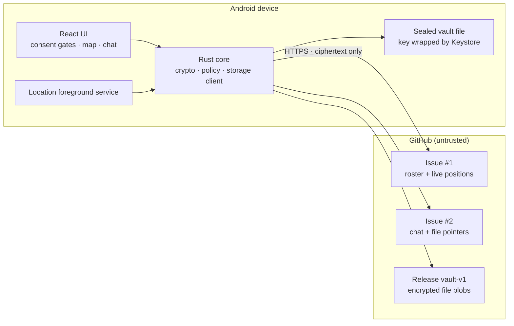

# Shadow720

A serverless, end-to-end encrypted group app for live location, chat, and file
sharing — a self-hosted alternative to family-locator apps. Tauri v2 (Rust core +
TypeScript UI) with two storage backends: a private GitHub repository, or public
Nostr relays. Both store **only ciphertext**.

There is no server and no account. Every payload is sealed on the device before it
leaves.

**Status:** builds, passes its test suite, and runs on Windows and Android. Not yet
reviewed by Play, and the Android build has not been exercised on physical hardware.

---

## Download

Prebuilt packages are attached to each [release](../../releases):

| Platform | File | Notes |
|---|---|---|
| Windows | `Shadow720_<version>_x64-setup.exe` | Installer; also `.msi` |
| Android | `Shadow720_<version>_arm64.apk` | Android 8.0+ (API 26), arm64 |

The Android APK is signed with a self-signed key, so Android will ask you to allow
installing from an unknown source. That is expected for an app distributed outside
Play.

---

## What works

| Area | State |
|---|---|
| Rust core | 410 unit tests |
| TypeScript UI | `tsc --noEmit` clean, production bundle builds |
| Map | OpenStreetMap basemap, follows the OS light/dark theme, fading travel trails |
| Activity | Stationary / walking / running / cycling / driving, from reported speed |
| Groups | Multiple groups per device, switchable offline |
| Deletion | Author-signed message deletion, host-signed group closure, Blossom blob deletion |
| Play artefacts | Privacy policy, Data Safety worksheet, declaration answers, demo-video shot list |

---

## Architecture



### Storage mapping

GitHub Issues and Releases act as the database. Nothing is ever written to the Git
tree, which is what avoids `409 Conflict` races and keeps `.git` history from
growing with chat.

| Logical table | GitHub primitive | Concurrency safety |
|---|---|---|
| Member roster + live location | Issue #1, one comment per member | each member only ever `PATCH`es **its own** comment id, so N phones never collide |
| Group chat + file pointers | Issue #2 comments | append-only |
| Encrypted file vault | `vault-v1` release assets | oldest-first pruning at a 500 MB ceiling |

### Security model

- **Confidentiality and integrity:** `XChaCha20-Poly1305` for all payloads, invites,
  and file blobs.
- **Authenticity:** `Ed25519` over a length-prefixed canonical form that includes the
  protocol version, key epoch, sender key, nonce, and ciphertext.
- **Key agreement:** the join password derives an invite wrapping key via `Argon2id`
  (`m=19456, t=2, p=1`); the group key rides inside the encrypted invite.
- **At rest:** a sealed vault file whose key is wrapped by the Android Keystore, so a
  copy of the app's files is useless on another device.
- **Rotation:** key epochs, so a removed member loses access to everything written
  after the rotation while older content stays readable.

See [PLAN_ADDENDUM_v1.md](./PLAN_ADDENDUM_v1.md) §A11 for the deviations discovered
during implementation.

---

## Layout

```
src/                      React UI
  lib/api.ts              typed bridge to every Rust command
  lib/location.ts         geolocation, permissions, background toggle
  components/             consent gates, map, chat, settings
src-tauri/
  src/crypto.rs           keys, invites, envelopes, file blobs
  src/geo_filter.rs       movement gate, cadence, jitter, backoff
  src/github_db.rs        ETag cache, comments, release assets, pruning
  src/vault.rs            sealed vault + Keystore trait
  src/group.rs            in-memory group state and policy
  src/commands.rs         the `#[tauri::command]` surface
  src/keystore_android.rs Android-only plugin bridge
  gen/android/            generated Android project
    .../KeystoreVaultPlugin.kt        wraps the vault password in the Keystore
    .../LocationServicePlugin.kt      controls the foreground service
    .../LocationForegroundService.kt  the service itself
docs/play/                Play Store submission artefacts
```

---

## Building

### Prerequisites

Verified working set:

- Rust 1.93 with the `aarch64-linux-android` target
- Android SDK with platform 36 and build-tools 36
- Android NDK 27.0.12077973
- JDK 21
- Node 24

### Tests and lint

```powershell
npm run test:rust     # 410 tests
npm run lint:rust     # clippy, warnings denied
npm run typecheck
```

### Frontend

```powershell
npm install
npm run build         # typecheck, then vite build
```

### Android APK

`tauri android build` needs Windows Developer Mode for the symlink step. Without it,
use this sequence, which is what the verified build used:

```powershell
$env:ANDROID_HOME = "$env:LOCALAPPDATA\Android\Sdk"
$env:NDK_HOME    = "$env:LOCALAPPDATA\Android\Sdk\ndk\27.0.12077973"
$env:JAVA_HOME   = "C:\Program Files\Eclipse Adoptium\jdk-21.0.12.101-hotspot"

cd src-tauri
cargo build --release --target aarch64-linux-android

$jni = "gen\android\app\src\main\jniLibs\arm64-v8a"
New-Item -ItemType Directory -Force -Path $jni | Out-Null
Copy-Item "target\aarch64-linux-android\release\libshadow720_lib.so" "$jni\libshadow720_lib.so" -Force

cd gen\android
# Gradle's rustBuild task re-invokes the Tauri CLI, so exclude it once the .so is staged.
.\gradlew.bat assembleArm64Debug -x rustBuildArm64Debug
```

Output: `src-tauri/gen/android/app/build/outputs/apk/arm64/debug/app-arm64-debug.apk`

### Release packages

`scripts/build-release.ps1` produces both downloadable artifacts and stages them in
`release/`:

```powershell
.\scripts\build-release.ps1
```

It builds the Windows installer with `tauri build`, then the signed Android APK, and
copies both into `release/`. The Android signing key is read from
`src-tauri/gen/android/keystore.properties`, which is gitignored; without it the APK
is unsigned and cannot be installed.

---

## Setting up a group

The app does the whole setup. There is nothing to create by hand and no token to paste.

1. In the app, choose **Create a group** and pick a repository host. Providers are
   grouped by whether they need an account; only GitHub is wired up today.
2. Choose **Create a new repo** and press **Sign in to GitHub**. A short code appears;
   enter it at the shown URL on any device you already have. The app polls until you
   approve, then continues on its own.
3. Enter a group name, a join password, and a display name.

The app then creates the private repository (with an initial commit), the roster and
chat issues, and the `vault-v1` release, and shows an invite string.

### Or skip accounts entirely with Nostr

Pick **Nostr** under "No account required" and there is no sign-in, no repository, and
no token at all. A keypair is generated on the device, and the invite carries only the
group key and a relay list.

This is strictly better for privacy: because each member signs their own events, a guest
can only write their own roster slot — the "every guest can destroy the repo" problem
does not exist. Relays also push over WebSocket, so there is no polling.

Trade-offs: relays are best-effort and may drop events, deletion is advisory, and
pubkeys/timestamps are public metadata. Publishing goes to several relays and succeeds
if any accepts.

Everything works on this backend — positions, chat, files, rotation checks, and leaving.
Three things behave differently, and the app says so rather than pretending otherwise:

- **Deleting your own message** sends a NIP-09 deletion request to the configured
  relays. Shadow720 hides messages with valid author-signed deletion requests, but
  relays and other clients may retain copies. The confirmation shows how many relays
  accepted the request; acceptance does not prove that copies were erased. Deleting
  a file message does not delete its blob. Reporting someone else's message publishes
  a flag; the local block list controls what you see.
- **Destroy Group** publishes a closure signed by the pinned host and wipes this
  device. Updated members automatically wipe their local group vault after receiving
  and verifying the closure. Offline or older clients may not receive it, and relay
  ciphertext, Blossom blobs, and downloaded copies remain.
- **Files** uploaded by this device can be deleted from the recorded Blossom server
  in Settings. The app publishes a signed removal notice; updated clients mark
  known references unavailable. Other servers, mirrors, and downloaded copies may
  remain. Older uploads without an ownership record cannot be deleted this way.

New file pointers use a non-replaceable event kind so relays can retain multiple
files from the same author. Updated clients can read legacy pointers; older builds
will not see new file pointers or closure/removal notices and should be upgraded.
The host identity, group configuration, and local upload records are stored in the
encrypted vault. Windows uses current-user DPAPI; Android uses its keystore.
Other desktop builds still use a nonpersistent development keystore. Older vaults
that did not store their identity cannot recover it; the app asks before discarding
one so a user can rejoin with a fresh invite.

Verify the transport yourself with `cargo run --example nostr_selftest` in `src-tauri`.

### Why sign-in instead of a token

Fine-grained personal access tokens **cannot be created through the API** — GitHub has
no endpoint for it, by design. Asking a user to open a browser, tick a dozen permission
checkboxes, and paste a string back is exactly the setup step this app avoids. The
OAuth device flow replaces it with one button: no client secret is involved, so the
`client_id` is compiled in safely.

The resulting token is account-scoped rather than repository-scoped. If you would rather
limit what an invite can do, expand **Use a repository-scoped token instead** in step 2
and paste a fine-grained token for the new repository with:

- `Contents: Read/Write`
- `Issues: Read/Write`
- `Administration: Read/Write` — required for in-app "Destroy Group"

Already have a repository? Choose **Use an existing repo** instead. Missing issues and
the vault release are created automatically.

Hand the invite plus the join password to each member over a channel you trust: guests
need no GitHub account.

> **The invite contains the token.** Anyone holding it can read the group and delete
> the repository. Rotation is the mitigation; it is called out in the privacy policy.

---

## Testing against `jaredch`

The live integration suite runs by default and reports skips when unconfigured.
Copy [.env.example](./.env.example) to `.env` and fill in:

```
SHADOWTEST_PAT=<fine-grained token for a sandbox repo>
SHADOWTEST_REPO=JaredCH/shadow720-sandbox
SHADOWTEST_ALLOW_DESTRUCTIVE=0
```

Use a **throwaway sandbox repo**, never the primary group repo. The suite redacts the
token from all output, asserts at least 500 requests remain before starting, and the
destructive case refuses to run without `SHADOWTEST_ALLOW_DESTRUCTIVE=1`.

---

## Play Store submission

| Artefact | File |
|---|---|
| Privacy policy | [docs/play/PRIVACY_POLICY.md](./docs/play/PRIVACY_POLICY.md) |
| Field-by-field Console answers | [docs/play/PLAY_CONSOLE_ANSWERS.md](./docs/play/PLAY_CONSOLE_ANSWERS.md) |
| Data safety worksheet | [docs/play/DATA_SAFETY_WORKSHEET.md](./docs/play/DATA_SAFETY_WORKSHEET.md) |
| Background-location demo video plan | [docs/play/DEMO_VIDEO_SCRIPT.md](./docs/play/DEMO_VIDEO_SCRIPT.md) |

Two placeholders must be filled before submitting: the contact address and the legal
provider in the privacy policy.

---

## Known limitations

- **Every guest holds the host's token.** This is inherent to having no server. A guest
  can therefore delete any comment and destroy the repository.
- **Rotation is not retroactive.** A removed member who kept an old invite can still
  read content written before the rotation.
- **A re-key does not revoke the old token.** The host must revoke it on GitHub; the
  app only replaces its own copy.
- **The map fetches OpenStreetMap tiles**, so the tile server sees the viewport
  coordinates being requested. Positions themselves stay encrypted; only the map area
  you are looking at is disclosed. The basemap follows the operating system's light or
  dark setting.
- **Activity is inferred from reported speed**, not from a motion sensor. A device that
  reports no speed shows as stationary even while moving.
- **Trails are local and short.** Each member's recent positions are kept in memory on
  this device only, capped at 60 points, and are not published or shared.
- **`CAMERA` is declared but unused** until QR scanning ships. Remove it, or ship the
  feature, before release.
- **Not yet run on a physical device.** Background location, the Keystore round trip,
  and the foreground-service notification are compiled and configured but unverified
  on hardware.