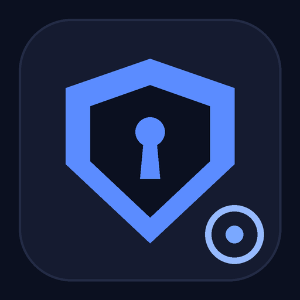
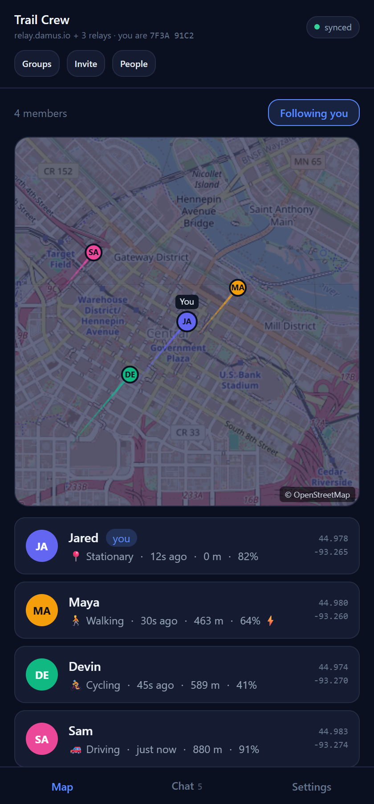
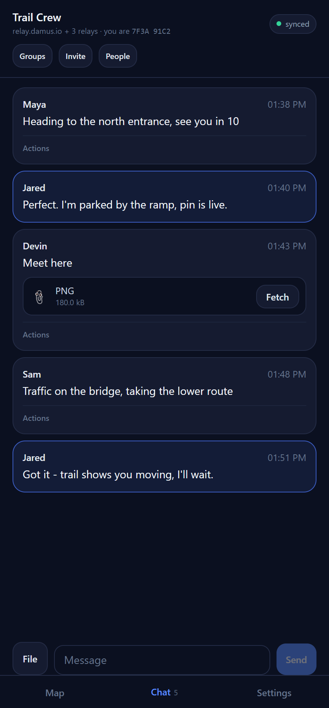
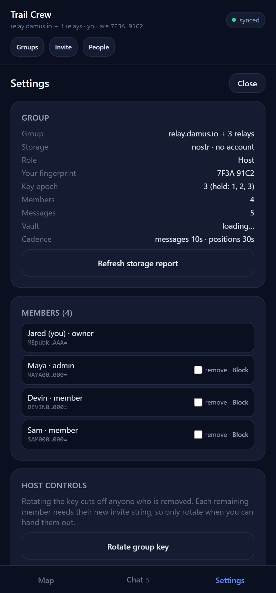
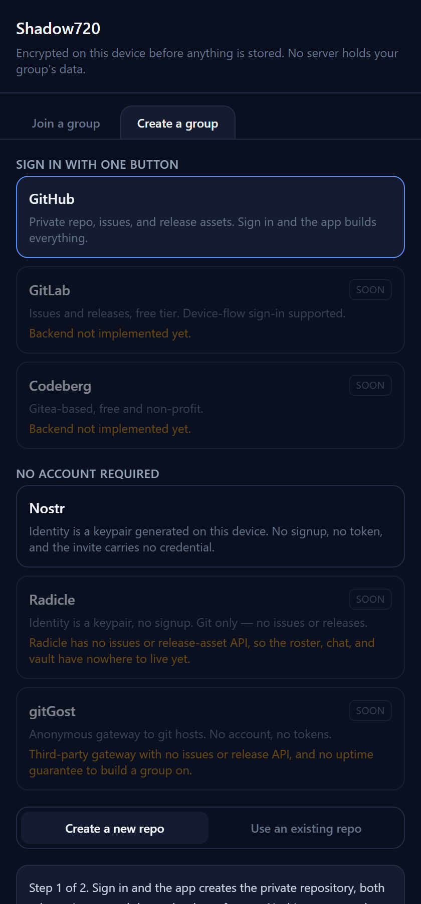
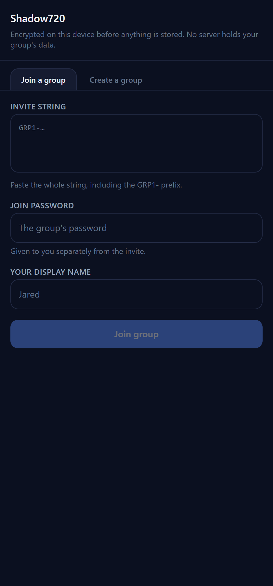
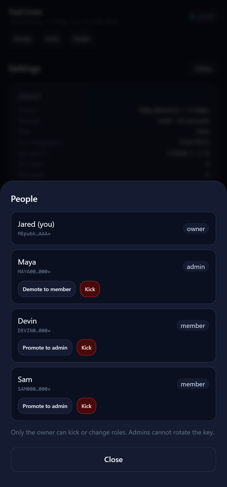
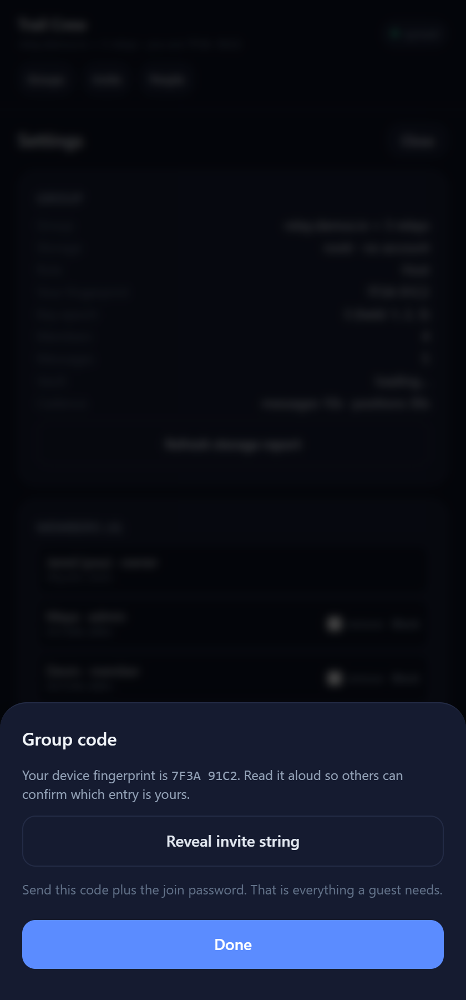
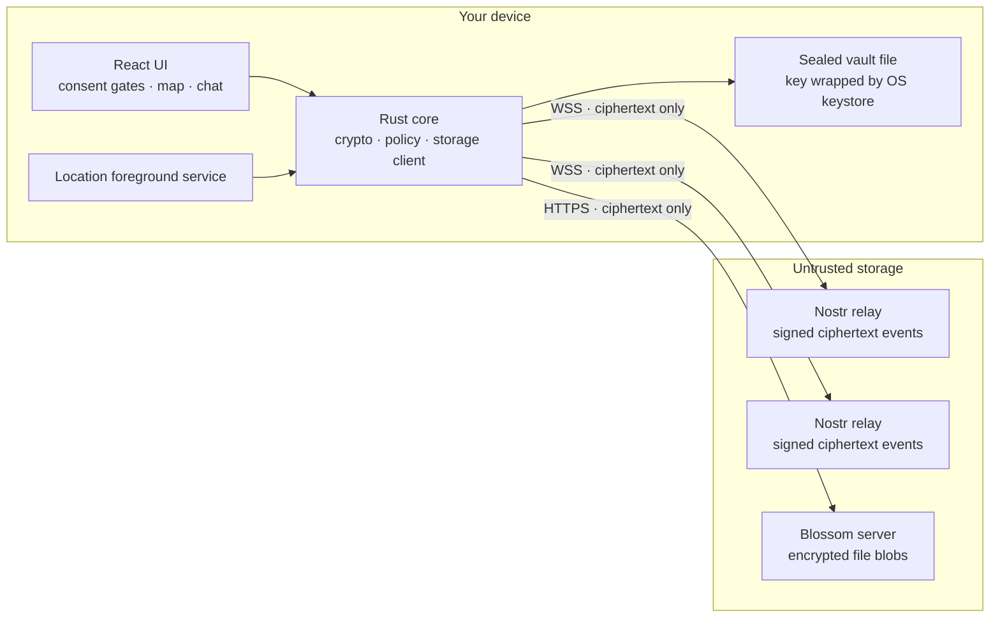

<div align="center">



# Shadow720

### Live location, chat, and file sharing for your group — with no server, no account, and no one who can read it.

**Free forever. $0 to run. No subscription, no per-seat pricing, no hosting bill.**

[](./src-tauri)
[](https://v2.tauri.app)
[](./src)
[](#download)
[](./LICENSE)

[Download](#download) · [What it does](#what-it-does) · [Security](#security-model) · [Build it](#building) · [Limitations](#known-limitations)

</div>

---

<div align="center">

| **See everyone, live** | **Talk without being read** | **Stay in control** |
|:---:|:---:|:---:|
|  |  |  |
| A real map, real trails, real activity — walking, cycling, driving — refreshed every 30 seconds. | Messages and files sealed on your phone before they leave it. | Key epochs, member roles, rotation, and a wipe button that actually wipes. |

</div>

---

## What it does

Shadow720 is a **private group app** for the people you actually trust: your family, your hiking group, your crew. It shows everyone on a live map, carries a group chat, and moves files between you.

The difference is what it *doesn't* have.

> **There is no server. There is no account. There is no company in the middle.**
>
> Every position, message, and file is encrypted on your device with `XChaCha20-Poly1305` and signed with `Ed25519` **before** it is stored anywhere. The place it gets stored — a public Nostr relay — only ever holds ciphertext. It cannot read your group, and neither can we.

### The cost

| | Shadow720 | Typical family-locator app |
|---|---|---|
| Monthly price | **$0** | $5–$15 per group |
| Per-seat fee | **$0** | Often |
| Server to run | **None** | Required |
| Who can read your location | **Only your group** | The vendor |
| Account required | **None** | Yes, per member |
| Data retention you control | **Yes — you hold the keys** | Vendor policy |

There is nothing to host, so there is nothing to pay for. The storage is free-tier infrastructure that already exists: public Nostr relays and Blossom blob servers. The app is MIT-licensed and the whole thing runs on your hardware.

---

## ⚠️ Right now, Nostr is the only working option

The provider picker lists six backends. **Only Nostr is wired end to end today.** The others are shown with an explicit "soon" badge rather than hidden, so the app never promises something the backend cannot do.

<div align="center">

</div>

| Provider | State | Why |
|---|---|---|
| **Nostr** | ✅ **The only working option** | Keypair identity, no signup, no token, no repository. Everything works: positions, chat, files, rotation, leaving. |
| GitHub | ⚠️ Not working right now | Needs an account and a token, and the flow is being reworked. Do not rely on it. |
| GitLab · Codeberg · Radicle · gitGost | ⏳ Soon | Backend not implemented. |

**Why Nostr is the better default anyway:** identity is a keypair generated on your device, so there is no signup and no credential in the invite. Each member signs their own events, so a guest can only write their own roster slot — the "every guest can destroy the repo" problem simply does not exist. Relays push over WebSocket, so there is no polling.

---

## Download

Prebuilt packages are attached to each [release](../../releases):

| Platform | File | Notes |
|---|---|---|
| Windows | `Shadow720_<version>_x64-setup.exe` | Installer; also `.msi` |
| Android | `Shadow720_<version>_arm64.apk` | Android 8.0+ (API 26), arm64 |

The Android APK is signed with a self-signed key, so Android will ask you to allow installing from an unknown source. That is expected for an app distributed outside Play.

---

## Getting a group running in 60 seconds

<div align="center">

</div>

**Create a group**

1. Open the app and accept the terms and location disclosure.
2. Choose **Create a group** → **Nostr**.
3. Enter a group name, a join password, and your display name.

That's it. A keypair is generated on the device, the group key is sealed inside the invite, and you get a `GRP1-…` string to share.

**Join a group**

Paste the invite string, enter the join password you were given separately, and pick a display name. No account, no email, no verification.

> Hand the invite and the password over two different channels you trust. Together they are the only thing protecting the group.

---

## What works

| Area | State |
|---|---|
| Rust core | **415 unit tests**, all passing |
| TypeScript UI | `tsc --noEmit` clean, production bundle builds |
| Map | OpenStreetMap basemap, follows the OS light/dark theme, fading travel trails |
| Activity | Stationary / walking / running / cycling / driving, from reported speed |
| Groups | Multiple groups per device, switchable offline |
| Chat | Text, file pointers, per-message moderation, author-signed deletion |
| Roles | Owner / admin / member, with owner-only kick and key rotation |
| Deletion | Author-signed message deletion, host-signed group closure, Blossom blob deletion |
| Play artefacts | Privacy policy, Data Safety worksheet, declaration answers, demo-video shot list |

<div align="center">

| People & roles | Group code |
|:---:|:---:|
|  |  |

</div>

---

# Under the hood

Everything below is for people who want to know exactly what they are trusting.

## Architecture



The Rust core owns every decision that matters: what gets encrypted, what gets signed, when a position is worth publishing, and how hard to back off when a relay pushes back. The React layer is a view over typed commands — it never touches a key.

### Storage mapping

| Logical table | Nostr primitive | Concurrency safety |
|---|---|---|
| Member roster + live location | kind `30078`, addressable per member | each member only ever writes **their own** `d`-tag slot, so N phones never collide |
| Group chat | kind `30079`, addressable per message | append-only |
| File pointers | kind `8096`, non-replaceable | relays retain multiple files from the same author |
| Encrypted file vault | Blossom blobs, addressed by SHA-256 | content-addressed, so a re-upload is a no-op |
| Rotation / closure / control | kinds `30081`, `30082`, `8098` | signed by the pinned host |
| Deletion | kind `5` (NIP-09), author-signed | advisory by design — see [limitations](#known-limitations) |

Default relays: `relay.damus.io`, `nos.lol`, `relay.primal.net`. Publishing goes to all of them and succeeds if any accepts. Default blob host: `blossom.nostr.build`.

### Movement and cadence policy

Publishing every GPS fix would burn battery and flood relays, so the core gates it:

| Constant | Value | Meaning |
|---|---|---|
| `MIN_MOVE_METERS` | 15 m | below this, a fix is not worth publishing |
| `MIN_INTERVAL_SECS` | 30 s | floor between publishes |
| `HEARTBEAT_SECS` | 900 s | publish anyway every 15 min so a still member stays fresh |
| `JITTER_FRACTION` | ±25% | so 50 phones never align into a thundering herd |
| `BACKOFF_THRESHOLD` / `FACTOR` / `CAP` | 3 / 2.0× / 300 s | adaptive backoff when a relay stops answering |
| `RATE_LIMIT_PADDING_SECS` | 60 s | extra wait past a reported rate-limit reset |

Activity is inferred from reported speed: `< 0.8 m/s` stationary, `< 1.5` walking, `< 4.0` running, `< 8.0` cycling, above that driving.

---

## Security model

| Property | Mechanism |
|---|---|
| **Confidentiality** | `XChaCha20-Poly1305` for all payloads, invites, and file blobs |
| **Integrity** | AEAD tag over every payload; SHA-256 over every file blob |
| **Authenticity** | `Ed25519` over a length-prefixed canonical form including protocol version, key epoch, sender key, nonce, and ciphertext |
| **Key agreement** | join password → invite wrapping key via `Argon2id` (`m=19456, t=2, p=1`); the group key rides inside the encrypted invite |
| **At rest** | sealed vault file whose key is wrapped by the OS keystore — Android Keystore, Windows DPAPI — so a copy of the app's files is useless on another device |
| **Rotation** | key epochs: a removed member loses access to everything written after the rotation, while older content stays readable |
| **Transport** | `rustls` only, no OpenSSL; WebSocket for relays, HTTPS for blobs |
| **Memory hygiene** | `zeroize` on key material, `ZeroizeOnDrop` on invite payloads, no plaintext kept in React state longer than a render |

### What the storage provider can see

| Visible | Not visible |
|---|---|
| That *some* pubkey published *an* event at *some* time | Positions, messages, file contents, display names |
| Event sizes and counts | Group membership (roster entries are encrypted) |
| Which relays you connect to | Your join password or group key |
| The map viewport you are looking at (tile requests) | Anything about who else is in the group |

### Threat model, stated plainly

- **A relay operator** sees ciphertext and metadata. They cannot read your group.
- **A stolen device** yields a vault file that is useless without the OS keystore.
- **A removed member** keeps whatever they already downloaded. Rotation is not retroactive.
- **The app's authors** have no server, no telemetry, and no way to reach your data.

---

## Dependencies

Deliberately small. Every crate below is doing a job that cannot be done safely by hand.

### Rust core

| Crate | Why |
|---|---|
| `tauri` 2 | app shell, IPC, plugin host |
| `chacha20poly1305` 0.10 | XChaCha20-Poly1305 AEAD |
| `ed25519-dalek` 2 | signatures, with `zeroize` |
| `argon2` 0.5 | password-based key derivation |
| `secp256k1` 0.33 | Nostr keypairs and event signing |
| `tokio-tungstenite` 0.30 | relay WebSocket transport |
| `reqwest` 0.12 (`rustls-tls`) | HTTPS with no OpenSSL dependency |
| `zeroize` 1 | wipe key material on drop |
| `subtle` 2 | constant-time comparison |
| `sha2` 0.10 | blob addressing and integrity |
| `zstd` 0.13 | compress the invite payload |
| `dashmap` 6 · `parking_lot` 0.12 | concurrent caches without lock poisoning |
| `thiserror` 2 | typed errors, no panics in runtime code |
| `windows-sys` 0.61 | DPAPI on Windows |

### Frontend

| Package | Why |
|---|---|
| `react` 19 · `react-dom` 19 | UI |
| `@tauri-apps/api` 2 + plugins | clipboard, dialog, geolocation, notification, os, shell, store |
| `vite` 7 · `typescript` 5.9 | build and typecheck |
| `tailwindcss` 3.4 | styling |

**No map library.** The map is a canvas with its own Web Mercator projection and gesture model — one projection, one event model, no extra dependency, and a `none` basemap mode that skips the network entirely.

---

## Layout

```
src/                      React UI
  lib/api.ts              typed bridge to every Rust command
  lib/location.ts         geolocation, permissions, background toggle
  lib/tiles.ts            Web Mercator helpers for the canvas map
  components/             consent gates, map, chat, settings
src-tauri/
  src/crypto.rs           keys, invites, envelopes, file blobs
  src/nostr.rs            event construction and signing
  src/nostr_relay.rs      WebSocket relay transport
  src/nostr_store.rs      roster, chat, and blob storage on relays
  src/geo_filter.rs       movement gate, cadence, jitter, backoff
  src/github_db.rs        ETag cache, comments, release assets, pruning
  src/vault.rs            sealed vault + keystore trait
  src/group.rs            in-memory group state and policy
  src/commands.rs         the `#[tauri::command]` surface
  src/keystore_android.rs Android-only plugin bridge
  gen/android/            generated Android project
    .../KeystoreVaultPlugin.kt        wraps the vault password in the Keystore
    .../LocationServicePlugin.kt      controls the foreground service
    .../LocationForegroundService.kt  the service itself
docs/screens/             the screenshots in this README
docs/play/                Play Store submission artefacts
```

---

## Building

### Prerequisites

Verified working set:

- Rust 1.93 with the `aarch64-linux-android` target
- Android SDK with platform 36 and build-tools 36
- Android NDK 27.0.12077973
- JDK 21
- Node 24

### Tests and lint

```powershell
npm run test:rust     # 415 tests
npm run lint:rust     # clippy, warnings denied
npm run typecheck
```

### Frontend

```powershell
npm install
npm run build         # typecheck, then vite build
```

### Android APK

`tauri android build` needs Windows Developer Mode for the symlink step. Without it, use this sequence, which is what the verified build used:

```powershell
$env:ANDROID_HOME = "$env:LOCALAPPDATA\Android\Sdk"
$env:NDK_HOME    = "$env:LOCALAPPDATA\Android\Sdk\ndk\27.0.12077973"
$env:JAVA_HOME   = "C:\Program Files\Eclipse Adoptium\jdk-21.0.12.101-hotspot"

cd src-tauri
cargo build --release --target aarch64-linux-android

$jni = "gen\android\app\src\main\jniLibs\arm64-v8a"
New-Item -ItemType Directory -Force -Path $jni | Out-Null
Copy-Item "target\aarch64-linux-android\release\libshadow720_lib.so" "$jni\libshadow720_lib.so" -Force

cd gen\android
# Gradle's rustBuild task re-invokes the Tauri CLI, so exclude it once the .so is staged.
.\gradlew.bat assembleArm64Debug -x rustBuildArm64Debug
```

Output: `src-tauri/gen/android/app/build/outputs/apk/arm64/debug/app-arm64-debug.apk`

### Release packages

`scripts/build-release.ps1` produces both downloadable artifacts and stages them in `release/`:

```powershell
.\scripts\build-release.ps1
```

It builds the Windows installer with `tauri build`, then the signed Android APK, and copies both into `release/`. The Android signing key is read from `src-tauri/gen/android/keystore.properties`, which is gitignored; without it the APK is unsigned and cannot be installed.

---

## Appendix: the GitHub backend

Kept in the tree and still compiled, but not the supported path today. It is documented here so the code is not a mystery.

GitHub Issues and Releases act as the database. Nothing is ever written to the Git tree, which is what avoids `409 Conflict` races and keeps `.git` history from growing with chat.

| Logical table | GitHub primitive | Concurrency safety |
|---|---|---|
| Member roster + live location | Issue #1, one comment per member | each member only ever `PATCH`es **its own** comment id, so N phones never collide |
| Group chat + file pointers | Issue #2 comments | append-only |
| Encrypted file vault | `vault-v1` release assets | oldest-first pruning at a 500 MB ceiling |

**Why sign-in instead of a pasted token:** fine-grained personal access tokens cannot be created through the API — GitHub has no endpoint for it, by design. Asking a user to open a browser, tick a dozen permission checkboxes, and paste a string back is exactly the setup step this app avoids. The OAuth device flow replaces it with one button: no client secret is involved, so the `client_id` is compiled in safely.

The resulting token is account-scoped rather than repository-scoped. A repo-scoped fine-grained token needs `Contents: Read/Write`, `Issues: Read/Write`, and `Administration: Read/Write` (the last for in-app Destroy Group).

> **The invite contains the token.** Anyone holding it can read the group and delete the repository. Rotation is the mitigation; it is called out in the privacy policy. This is the main reason Nostr is the default.

---

## Verifying the transport yourself

The Nostr path has a self-test that exercises relay connect, publish, and read without touching the UI:

```powershell
cd src-tauri
cargo run --example nostr_selftest
```

---

## Testing against a live GitHub sandbox

The live integration suite runs by default and reports skips when unconfigured. Copy [.env.example](./.env.example) to `.env` and fill in:

```
SHADOWTEST_PAT=<fine-grained token for a sandbox repo>
SHADOWTEST_REPO=JaredCH/shadow720-sandbox
SHADOWTEST_ALLOW_DESTRUCTIVE=0
```

Use a **throwaway sandbox repo**, never the primary group repo. The suite redacts the token from all output, asserts at least 500 requests remain before starting, and the destructive case refuses to run without `SHADOWTEST_ALLOW_DESTRUCTIVE=1`.

---

## Play Store submission

| Artefact | File |
|---|---|
| Privacy policy | [docs/play/PRIVACY_POLICY.md](./docs/play/PRIVACY_POLICY.md) |
| Field-by-field Console answers | [docs/play/PLAY_CONSOLE_ANSWERS.md](./docs/play/PLAY_CONSOLE_ANSWERS.md) |
| Data safety worksheet | [docs/play/DATA_SAFETY_WORKSHEET.md](./docs/play/DATA_SAFETY_WORKSHEET.md) |
| Background-location demo video plan | [docs/play/DEMO_VIDEO_SCRIPT.md](./docs/play/DEMO_VIDEO_SCRIPT.md) |

Two placeholders must be filled before submitting: the contact address and the legal provider in the privacy policy.

---

## Known limitations

Honest list. The app says these out loud rather than pretending otherwise.

**Nostr backend**

- **Deleting your own message** sends a NIP-09 deletion request to the configured relays. Shadow720 hides messages with valid author-signed deletion requests, but relays and other clients may retain copies. The confirmation shows how many relays accepted the request; acceptance does not prove that copies were erased. Deleting a file message does not delete its blob.
- **Destroy Group** publishes a closure signed by the pinned host and wipes this device. Updated members automatically wipe their local group vault after receiving and verifying the closure. Offline or older clients may not receive it, and relay ciphertext, Blossom blobs, and downloaded copies remain.
- **Files** uploaded by this device can be deleted from the recorded Blossom server in Settings. The app publishes a signed removal notice; updated clients mark known references unavailable. Other servers, mirrors, and downloaded copies may remain. Older uploads without an ownership record cannot be deleted this way.
- **Relays are best-effort** and may drop events. Deletion is advisory. Pubkeys and timestamps are public metadata.
- **Reporting someone else's message** publishes a flag; the local block list controls what you see.

**General**

- **Rotation is not retroactive.** A removed member who kept an old invite can still read content written before the rotation.
- **The map fetches OpenStreetMap tiles**, so the tile server sees the viewport coordinates being requested. Positions themselves stay encrypted; only the map area you are looking at is disclosed. The basemap follows the operating system's light or dark setting.
- **Activity is inferred from reported speed**, not from a motion sensor. A device that reports no speed shows as stationary even while moving.
- **Trails are local and short.** Each member's recent positions are kept in memory on this device only, capped at 60 points, and are not published or shared.
- **`CAMERA` is declared but unused** until QR scanning ships. Remove it, or ship the feature, before release.
- **Not yet run on a physical device.** Background location, the Keystore round trip, and the foreground-service notification are compiled and configured but unverified on hardware.

**GitHub backend (not the supported path)**

- **Every guest holds the host's token.** This is inherent to having no server. A guest can therefore delete any comment and destroy the repository.
- **A re-key does not revoke the old token.** The host must revoke it on GitHub; the app only replaces its own copy.

---

## License

[MIT](./LICENSE)

<div align="center">

**No server. No account. No one reading over your shoulder.**

</div>
